# Phase 2 — Mise en place du pipeline Azure

Captures d’écran des principales étapes réalisées durant la deuxième phase du projet de prévision de la consommation électrique.

## 1. Création du compte de stockage Azure `stbriefforecast2026` dans la région North Europe.

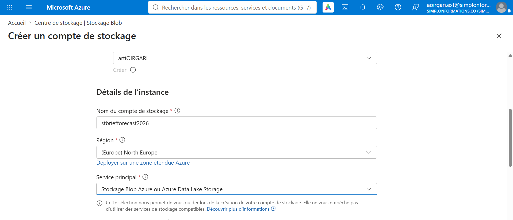

## 2. Création des conteneurs `source` et `datalake` pour organiser les données du projet.

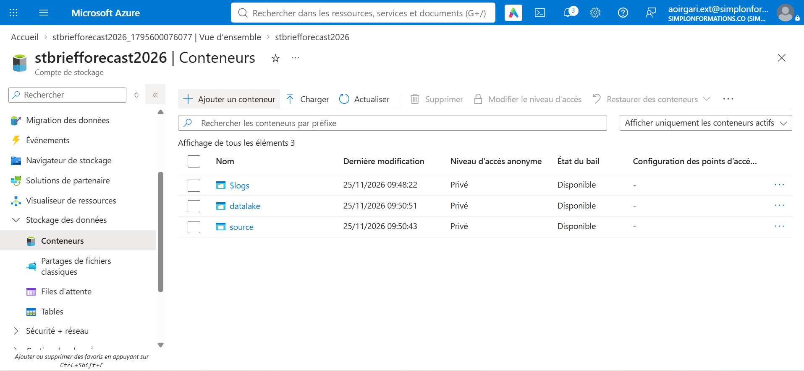

## 3. Chargement du fichier source `PJME_hourly.csv` dans le conteneur `source`.

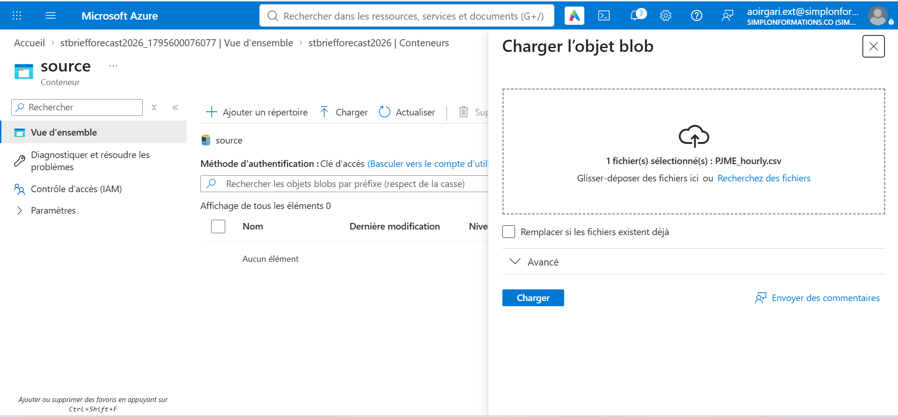

## 4. Ouverture d'Azure Data Factory Studio à partir de l'instance `adf-brief-forecast-2026`.

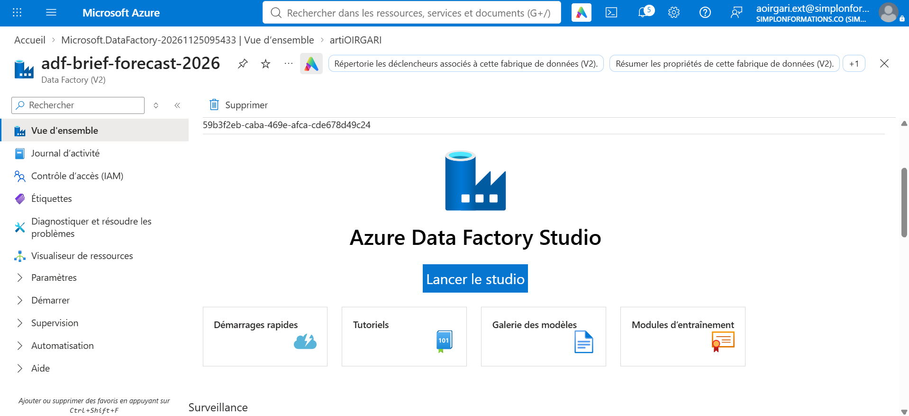

## 5. Création du service lié permettant à Data Factory d'accéder à Azure Data Lake Storage Gen2.

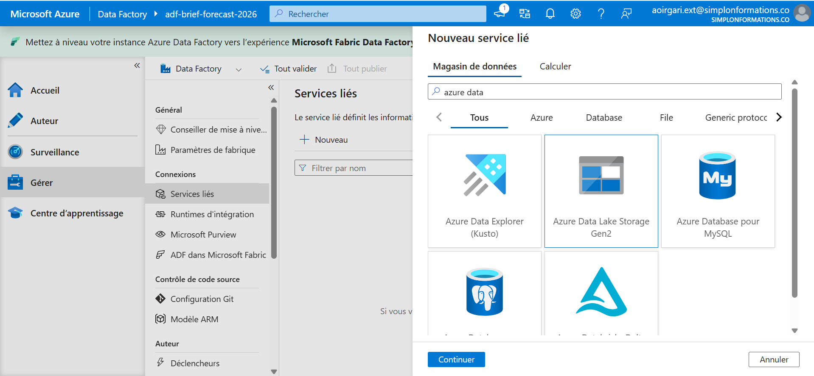

## 6. Configuration du dataset CSV `ds_raw_csv`, associé au conteneur de destination `datalake`.

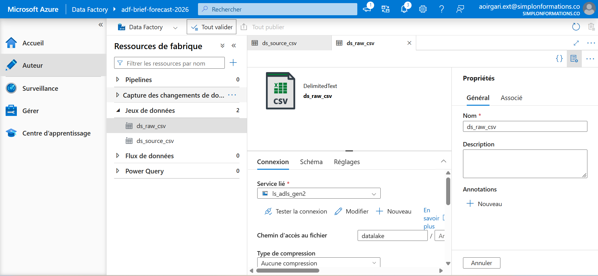

## 7. Construction du pipeline `pl_ingest_raw` avec les activités de vérification et de copie du fichier.

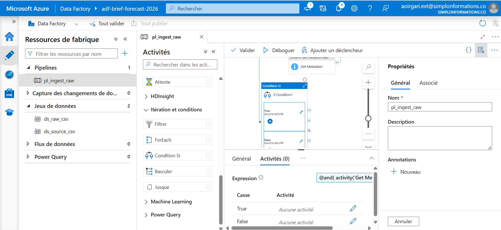

## 8. Exécution du pipeline d'ingestion et consultation du statut des activités dans l'onglet Sortie.

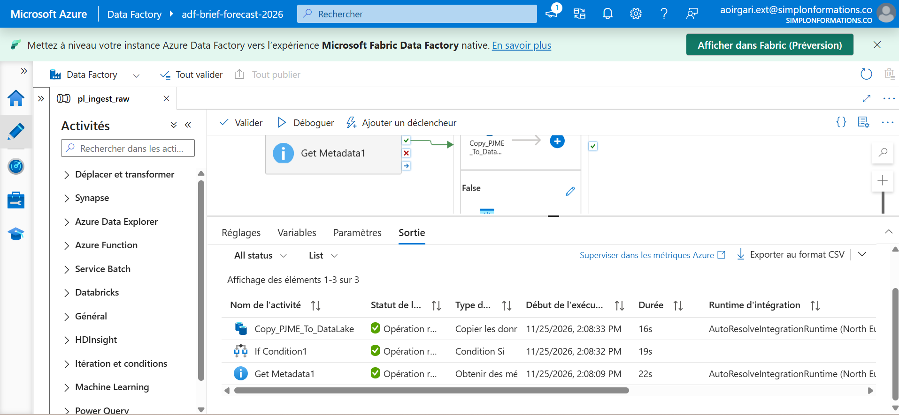

## 9. Vérification de la présence de `PJME_hourly.csv` dans le dossier `datalake/raw`.

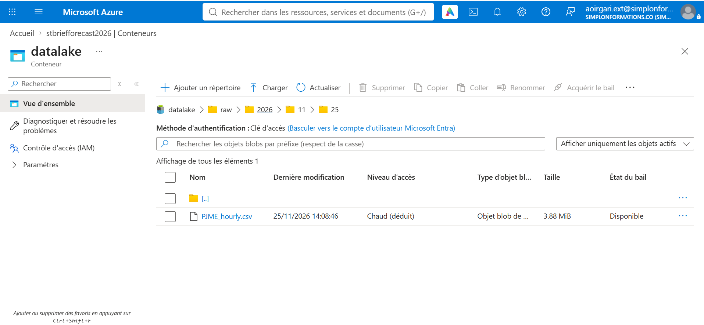

## 10. Création de l'espace de travail Azure Machine Learning `ml-brief-forecast-2026`.

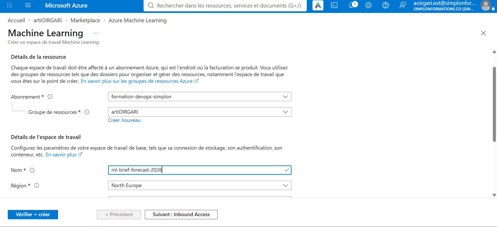

## 11. Ajout des composants de préparation et d'analyse des données dans Azure ML Designer.

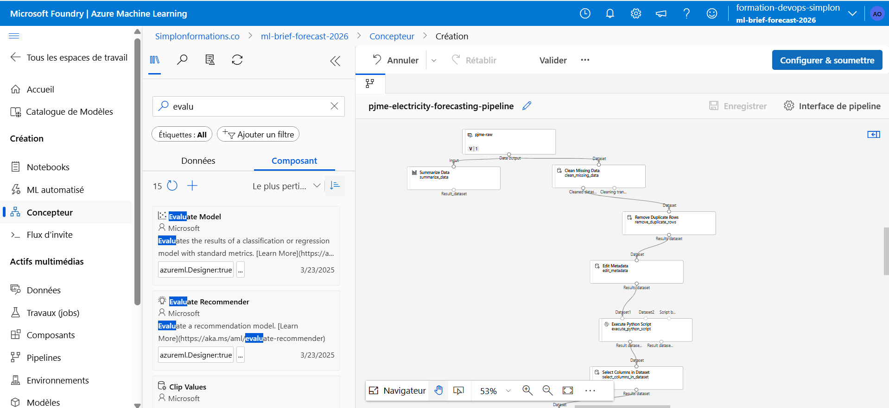

## 12. Organisation du workflow de séparation des données, d'entraînement et d'évaluation du modèle.

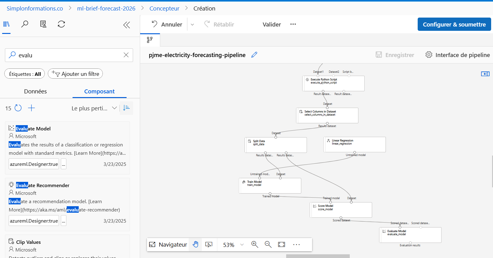

## 13. Consultation de l'exécution du pipeline Machine Learning dans la section Jobs.

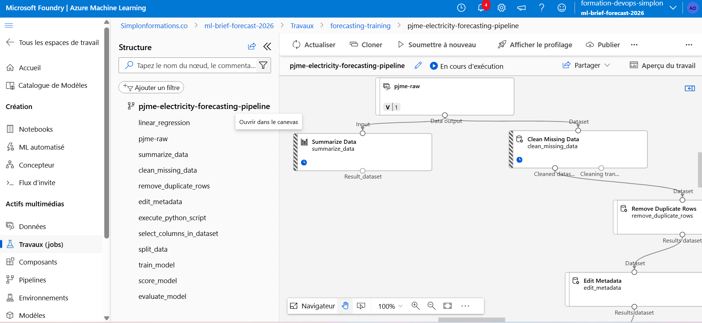

## 14. Visualisation des composants du workflow.

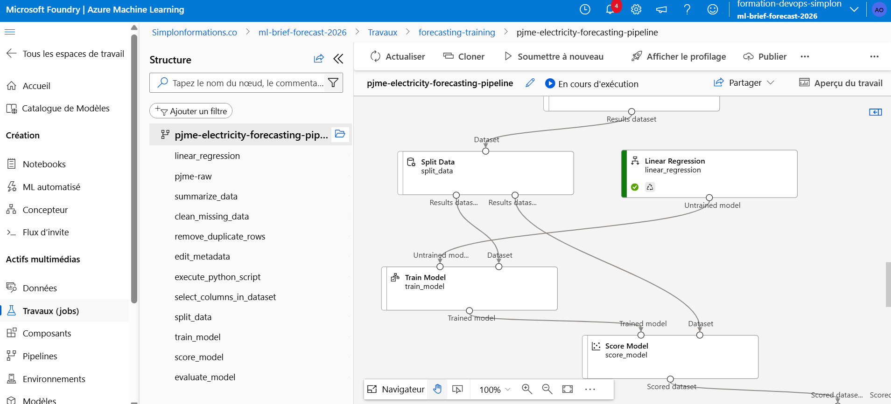

## 15. métriques d'évaluation.

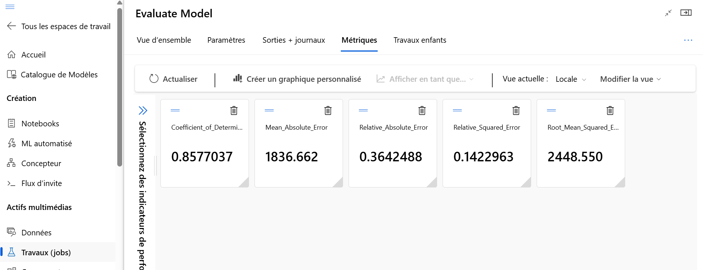